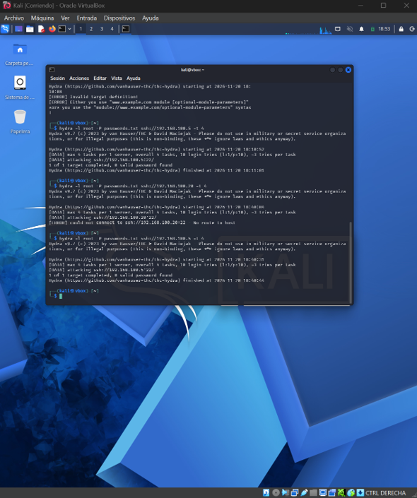
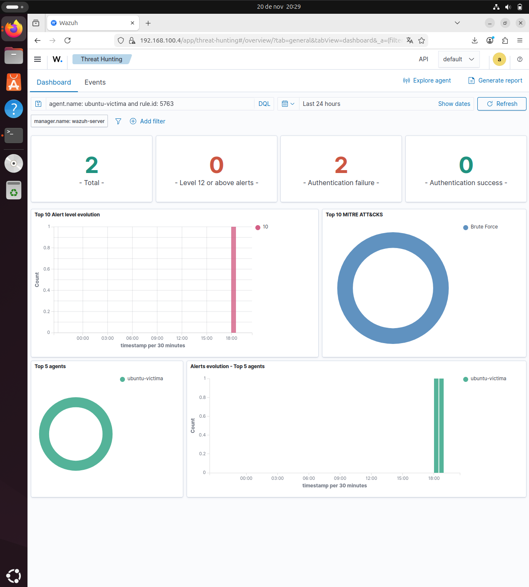
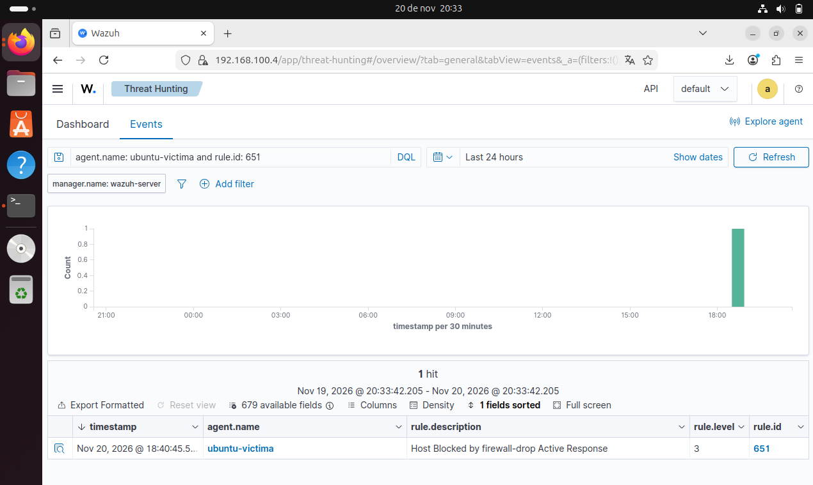

<div align="center">


<br><br>


</div>

<br>

# Detección de Fuerza Bruta SSH con Wazuh (SIEM)

Laboratorio casero de detección y respuesta a incidentes centrado en un **ataque de fuerza bruta por SSH**, construido con **Wazuh** sobre 3 máquinas virtuales en VirtualBox. Simula un escenario real de defensa: un servidor monitoreado, un equipo víctima con agente instalado, y un atacante (Kali + Hydra) intentando entrar por fuerza bruta — detectado y bloqueado automáticamente mediante respuesta activa.

Basado en la guía *"Wazuh para principiantes"* de Fatima Pérez, con reglas y configuración propias añadidas sobre la base de la guía.

<div align="center">

**[Arquitectura](#arquitectura)** · **[Qué incluye este repo](#qué-incluye-este-repo)** · **[Instalación](#1-instalación)** · **[Reglas personalizadas](#2-reglas-personalizadas)** · **[Simulación de ataque](#3-simulación-de-ataque-fuerza-bruta-ssh)** · **[Respuesta activa](#4-respuesta-activa-bloqueo-automático-de-ip)** · **[Reporte PDF](#reporte-wazuh-pdf)** · **[Herramientas](#herramientas-usadas)**

</div>

---

## Arquitectura

| | Máquina | Rol | IP (red NAT 192.168.100.0/24) |
|---|---|---|---|
|  | Ubuntu Server | Servidor Wazuh (manager + indexer + dashboard, all-in-one) | 192.168.100.4 |
|  | Ubuntu Desktop | Víctima (con agente de Wazuh instalado) | 192.168.100.5 |
|  | Kali Linux | Atacante | 192.168.100.6 |

Las 3 máquinas corren en una **NAT Network** de VirtualBox, aisladas de la red doméstica real pero con comunicación entre sí.

---

## Qué incluye este repo

| | Archivo | Contenido |
|---|---|---|
|  | [`rules/local_rules.xml`](./rules/local_rules.xml) | 3 reglas de detección personalizadas |
|  | [`config/active-response-ossec.conf`](./config/active-response-ossec.conf) | Configuración de respuesta activa (bloqueo automático de IP) |
|  | [`reporte/`](./reporte) | Reporte PDF exportado desde Wazuh |
|  | `README.md` | Explicación completa del proceso |

---

## 1. Instalación


- Wazuh instalado en modo **all-in-one** (manager + indexer + dashboard en una sola máquina) sobre Ubuntu Server.
- Agente de Wazuh instalado en Ubuntu Desktop y registrado contra el servidor — verificado como "Active" en el dashboard (`Agents`).

---

## 2. Reglas personalizadas

Se crearon 3 reglas propias en `local_rules.xml`, todas basadas en la regla predefinida **5715** (login SSH exitoso):

| ID | Nivel | Qué detecta |
|---|---|---|
| `100001` |  | Login SSH exitoso como usuario **root** |
| `100002` |  | Login SSH exitoso durante el **fin de semana** |
| `100003` |  | Actividad del usuario de servicio **deploy** |

<details>
<summary><b>Puntos clave aprendidos al construirlas</b> (clic para expandir)</summary>
<br>

- Toda regla personalizada necesita un `id` entre **100000 y 120000**.
- Para que una regla "hija" se evalúe, hay que anclarla a la regla "padre" con `<if_sid>` (si no, Wazuh nunca llega a evaluarla).
- Campos estáticos como `dstuser` **no** se pueden filtrar con `<field name="dstuser">`; existe la etiqueta dedicada `<user>` para eso.
- Se verificaron las 3 reglas con la herramienta **Ruleset Test** del dashboard antes de darlas por buenas (evita errores de decodificación por espacios de más en el log).

</details>

---

## 3. Simulación de ataque: fuerza bruta SSH


Desde Kali, usando **Hydra**, contra la IP real de la víctima:

```bash
hydra -l root -P passwords.txt ssh://192.168.100.5 -t 4
```



Resultado: Wazuh detectó el ataque mediante su regla predefinida **5763 — "sshd: Multiple failed logins in a small period of time"** (nivel 10), correlacionando los múltiples intentos fallidos desde la misma IP en una ventana de tiempo corta. Confirmado en **Threat Hunting** del dashboard.



---

## 4. Respuesta activa: bloqueo automático de IP


Se configuró `firewall-drop`, el script de respuesta activa de Wazuh basado en `iptables`, para que se dispare automáticamente cuando salta la regla 5763.

Configuración añadida en `/var/ossec/etc/ossec.conf` (ver [`config/active-response-ossec.conf`](./config/active-response-ossec.conf)):

- Bloque `<command>` declarando `firewall-drop` como ejecutable.
- Bloque `<active-response>` ligándolo a la regla `5763`, con `timeout` de 180 segundos.

**Flujo verificado de punta a punta:**

| Paso | Evento |
|---|---|
| 1 | Hydra ataca por SSH → regla **5763** se dispara |
| 2 | Wazuh ejecuta `firewall-drop` → la IP del atacante queda bloqueada (`iptables DROP`) |
| 3 | Se genera la alerta de regla **651** — *"Host Blocked by firewall-drop Active Response"*, confirmando que la respuesta activa se ejecutó |
| 4 | Pasados los 180 segundos configurados, el bloqueo se revierte automáticamente (comportamiento esperado de una respuesta activa "stateful" con `timeout` definido, no un error) |



---

## Reporte Wazuh (PDF)

Reporte exportado directamente desde el dashboard de Wazuh con el resumen de alertas, agentes y eventos del laboratorio.

<div align="center">

<a href="./reporte/wazuh-reporte.pdf">
<br>
<b>Ver reporte PDF</b>
</a>

</div>

---

## Herramientas usadas

<div align="center">

<table>
<tr>
<td align="center" width="140">
<br>
<sub><b>VirtualBox</b></sub>
</td>
<td align="center" width="140">
<br>
<sub><b>Ubuntu</b></sub>
</td>
<td align="center" width="140">
<br>
<sub><b>Kali Linux</b></sub>
</td>
<td align="center" width="140">
<br>
<sub><b>Wazuh 4.14</b></sub>
</td>
<td align="center" width="140">
<br>
<sub><b>Hydra</b></sub>
</td>
</tr>
</table>

</div>

---

## Créditos

Este laboratorio se realizó siguiendo como referencia la guía *"Wazuh para principiantes"* de Fatima Pérez. Todas las configuraciones, capturas, pruebas de ataque y soluciones a errores documentadas aquí son resultado de mi propia implementación en mi entorno virtual.
