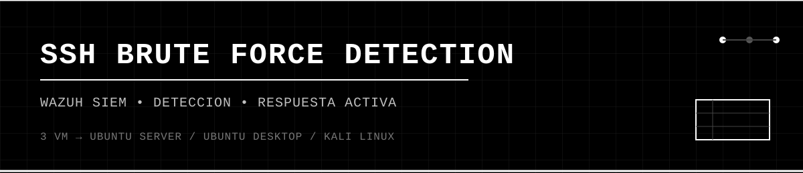

<div align="center">



<br><br>


</div>

<br>

# Laboratorio de Ciberseguridad con Wazuh (SIEM)

Laboratorio casero de detección y respuesta a incidentes, construido con **Wazuh** sobre 3 máquinas virtuales en VirtualBox. Simula un escenario real de defensa: un servidor monitoreado, un equipo víctima con agente instalado, y un atacante lanzando un ataque de fuerza bruta por SSH — detectado y bloqueado automáticamente.

Basado en la guía *"Wazuh para principiantes"* de Fatima Pérez, con reglas y configuración propias añadidas sobre la base de la guía.

---

## Arquitectura

| Máquina | Rol | IP (red NAT 192.168.100.0/24) |
|---|---|---|
| Ubuntu Server | Servidor Wazuh (manager + indexer + dashboard, all-in-one) | 192.168.100.4 |
| Ubuntu Desktop | Víctima (con agente de Wazuh instalado) | 192.168.100.5 |
| Kali Linux | Atacante | 192.168.100.6 |

Las 3 máquinas corren en una **NAT Network** de VirtualBox, aisladas de la red doméstica real pero con comunicación entre sí.

---

## Qué incluye este repo

- [`rules/local_rules.xml`](./rules/local_rules.xml) — 3 reglas de detección personalizadas
- [`config/active-response-ossec.conf`](./config/active-response-ossec.conf) — configuración de respuesta activa (bloqueo automático de IP)
- [`reporte/`](./reporte) — reporte PDF exportado desde Wazuh
- Este README, con la explicación completa del proceso

---

## 1. Instalación

- Wazuh instalado en modo **all-in-one** (manager + indexer + dashboard en una sola máquina) sobre Ubuntu Server.
- Agente de Wazuh instalado en Ubuntu Desktop y registrado contra el servidor — verificado como "Active" en el dashboard (`Agents`).

---

## 2. Reglas personalizadas

Se crearon 3 reglas propias en `local_rules.xml`, todas basadas en la regla predefinida **5715** (login SSH exitoso):

| ID | Nivel | Qué detecta |
|---|---|---|
| 100001 | 10 | Login SSH exitoso como usuario **root** |
| 100002 | 9 | Login SSH exitoso durante el **fin de semana** |
| 100003 | 8 | Actividad del usuario de servicio **deploy** |

Puntos clave aprendidos al construirlas:

- Toda regla personalizada necesita un `id` entre **100000 y 120000**.
- Para que una regla "hija" se evalúe, hay que anclarla a la regla "padre" con `<if_sid>` (si no, Wazuh nunca llega a evaluarla).
- Campos estáticos como `dstuser` **no** se pueden filtrar con `<field name="dstuser">`; existe la etiqueta dedicada `<user>` para eso.
- Se verificaron las 3 reglas con la herramienta **Ruleset Test** del dashboard antes de darlas por buenas (evita errores de decodificación por espacios de más en el log).

---

## 3. Simulación de ataque: fuerza bruta SSH

Desde Kali, usando **Hydra**, contra la IP real de la víctima:

```bash
hydra -l root -P passwords.txt ssh://192.168.100.5 -t 4
```

Resultado: Wazuh detectó el ataque mediante su regla predefinida **5763 — "sshd: Multiple failed logins in a small period of time"** (nivel 10), correlacionando los múltiples intentos fallidos desde la misma IP en una ventana de tiempo corta. Confirmado en **Threat Hunting** del dashboard.

<!--
  PANTALLAZO: alerta de la regla 5763 en Threat Hunting mostrando
  el ataque de fuerza bruta detectado.
  Reemplaza la línea de abajo por: 
-->


---

## 4. Respuesta activa: bloqueo automático de IP

Se configuró `firewall-drop`, el script de respuesta activa de Wazuh basado en `iptables`, para que se dispare automáticamente cuando salta la regla 5763.

Configuración añadida en `/var/ossec/etc/ossec.conf` (ver [`config/active-response-ossec.conf`](./config/active-response-ossec.conf)):

- Bloque `<command>` declarando `firewall-drop` como ejecutable.
- Bloque `<active-response>` ligándolo a la regla `5763`, con `timeout` de 180 segundos.

Flujo verificado de punta a punta:

1. Hydra ataca por SSH → regla **5763** se dispara.
2. Wazuh ejecuta `firewall-drop` → la IP del atacante queda bloqueada (`iptables DROP`).
3. Se genera la alerta de regla **651 — "Host Blocked by firewall-drop Active Response"**, confirmando que la respuesta activa se ejecutó.
4. Pasados los 180 segundos configurados, el bloqueo se revierte automáticamente (comportamiento esperado de una respuesta activa "stateful" con `timeout` definido, no un error).

<!--
  PANTALLAZO: alerta de la regla 651 confirmando el bloqueo de IP
  por la respuesta activa.
  Reemplaza la línea de abajo por: 
-->


---

## Reporte Wazuh (PDF)

Reporte exportado directamente desde el dashboard de Wazuh con el resumen de alertas, agentes y eventos del laboratorio.

[`reporte/wazuh-reporte.pdf`](./reporte/wazuh-reporte.pdf)

---

## Herramientas usadas

VirtualBox · Ubuntu Server 22.04/24.04 · Ubuntu Desktop · Kali Linux · Wazuh 4.14 (manager, indexer, dashboard, agent) · Hydra

---

## Créditos

Este laboratorio se realizó siguiendo como referencia la guía *"Wazuh para principiantes"* de Fatima Pérez. Todas las configuraciones, capturas, pruebas de ataque y soluciones a errores documentadas aquí son resultado de mi propia implementación en mi entorno virtual.
